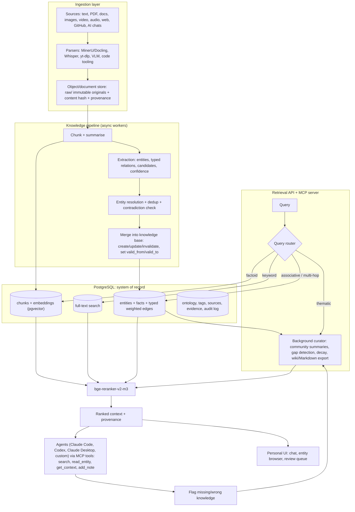
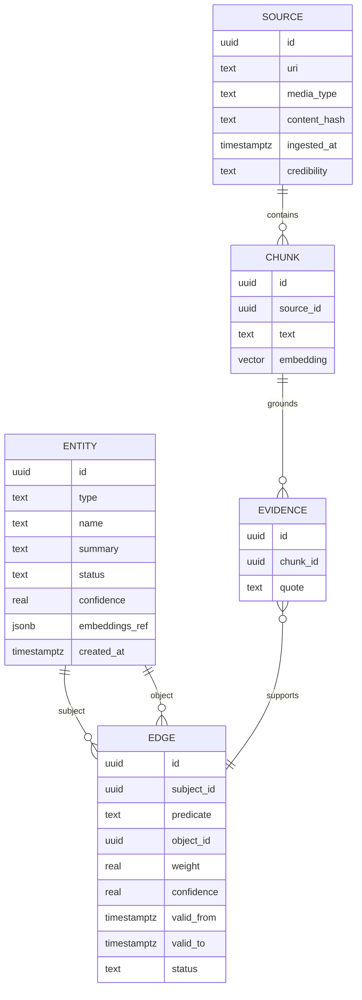

# Personal Second Brain and AI Knowledge Infrastructure: Research Report

**Prepared:** November 24, 2026 · Scope: open-source, local-first, model-independent personal knowledge systems · Audience: individual developer building a long-lived system with AI coding agents

---

## Question

How can an individual developer build a personal, continuously evolving knowledge system ("Second Brain") that:

1. ingests multimodal knowledge (text, PDFs, papers, images, video, audio, code, web content, AI conversations),
2. organises it as connected, weighted, temporally valid knowledge rather than isolated documents,
3. improves its own organisation over time without model retraining,
4. serves that knowledge to both the user and multiple independent AI agents (via MCP or equivalents),
5. remains open-source, local-first, provider-independent, and maintainable over many years,

so that every piece of acquired knowledge compounds into greater intelligence and effectiveness?

---

## Executive Summary

Ranked takeaways:

1. **No existing project implements the full vision, but roughly 80% of the pipeline can be assembled from existing open-source components.** The closest matches are Graphiti (temporal knowledge graphs), Cognee (ECL memory pipeline on Postgres), and the "LLM Wiki" pattern popularised by Andrej Karpathy. None of them combine multimodal ingestion, self-maintaining weighted knowledge graphs, multi-agent access, and personal-scale portability out of the box. The missing 20% is integration glue, a personal ontology, and a curator pipeline.
2. **The graph-vs-vector question is settled in practice: use a hybrid.** Systematic evaluations show plain vector RAG wins on direct factoid retrieval, while graph-augmented retrieval wins on multi-hop, associative, and corpus-level "what are the themes" questions ([RAG vs. GraphRAG, arXiv](https://arxiv.org/html/2502.11371v3), [HippoRAG, arXiv](https://arxiv.org/abs/2405.14831), [Zep, arXiv](https://arxiv.org/abs/2501.13956)). Every serious memory framework converged on graph + vector + full-text hybrid retrieval.
3. **A PostgreSQL-centric architecture is the best fit for this use case.** One Postgres instance can hold relational facts, a property graph, pgvector embeddings, and full-text search simultaneously. Cognee demonstrates the full graph/vector/relational memory stack running on a single Postgres instance ([Cognee docs](https://www.cognee.ai/knowledge-graph-llm)). This avoids Neo4j's GPL/commercial licensing, the death of Kuzu (archived October 2025 after Apple acquired the team, [WhichDB](https://whichdb.com/kuzu)), and multi-database operational overhead.
4. **Continuous learning is a process pattern, not a model feature.** The strongest current articulation is LangChain's "knowledge factory": consumer agents flag missing or wrong knowledge; a dedicated curator agent reconciles, updates, and maintains stores asynchronously; storage format is deliberately the least important piece ([LangChain blog, Nov 21 2026](https://www.langchain.com/blog/knowledge-factory)). Mem0, Zep, and Letta implement variants of the same loop (extract, consolidate, invalidate, retrieve).
5. **Treat vendor memory benchmarks with suspicion.** Claims on LoCoMo (used by Mem0, Zep, Letta and others) are undermined by a 2026 audit finding 6.4% of the answer key wrong and the LLM judge accepting up to 63% of intentionally wrong answers ([Penfield Labs](https://penfieldlabs.substack.com/p/we-audited-locomo-64-of-the-answer)). Build your own small evaluation set from your real questions.
6. **Ingestion costs are negligible; extraction quality is the real cost driver, and it is mostly a one-time backfill.** Embedding 100,000 documents (~800M tokens) costs about $16 with OpenAI's cheapest model or no marginal API spend locally (hardware, electricity and time still apply) ([pricing check, Nov 2026](https://www.activepieces.com/blog/openai-embeddings-api-pricing-in-2026-dated-and-checked)). LLM extraction (entities, relations, summaries) is 100x the embedding cost but still under ~$1,000 for 100k sources with cheap models, or at no API spend on a consumer GPU with an 8B open model, excluding hardware and time.
7. **The largest unsolved risk is content-borne attacks and knowledge poisoning, not technology.** OWASP's 2026 LLM Top 10 is led by prompt injection, with data poisoning and vector/embedding weaknesses as separate entries; "RAG is an identity and data-isolation problem disguised as a search feature" ([OWASP Top 10 agents analysis](https://blog.alexewerlof.com/p/owasp-top-10-ai-llm-agents)). Isolate ingested content as data, scope agent permissions, and keep the write path behind an approval gate.
**Cost figures caveat (updated in Part 3):** the estimates above exclude failed-processing retries, multimodal inference, periodic curation, relationship reassessment, retrieval reranking, and human review time; Part 3 defines the measured cost model, counted per successfully processed source and per useful retrieval.

---

## Methodology

**Search angles.** (1) Agent-memory frameworks and GraphRAG implementations; (2) storage engines (vector, graph, relational, embedded, server); (3) personal knowledge management and "second brain" applications; (4) infrastructure (LlamaIndex/LangChain ecosystems, MCP, document parsing, local embeddings); (5) academic evidence on retrieval architectures, temporal knowledge graphs, KG construction noise, and long-term memory benchmarks; (6) security literature on prompt injection and RAG poisoning; (7) licensing and maintenance verification for each shortlisted repository.

**Source types.** Official documentation and GitHub repositories, arXiv/NeurIPS/ACL/EMNLP/ICLR papers, vendor benchmark pages (treated as claims, not facts), independent engineering blogs, and one third-party benchmark audit.

**Limitations.** GitHub star counts and release notes were checked via search snippets and repository pages rather than full git history; some capability claims (e.g., Mem0 managed-platform numbers) are vendor-published and could not be independently reproduced. Cost estimates use published list prices as of November 2026 and are rounded; hardware estimates assume 2024-2026 consumer GPUs. The LoCoMo audit is a single independent source. Personal factors (university notes volume, Kulgo/Arhiiver project corpora) were not inspected and are handled as assumptions.

---

## Findings

### A. Existing solution landscape

**Nothing matches the full vision.** The landscape splits into four layers, each with strong options and critical gaps between them.

| Category | Strongest examples | What they actually deliver | What is missing for this vision |
|---|---|---|---|
| Temporal knowledge-graph memory | [Graphiti](https://github.com/getzep/graphiti) (Zep's open-source core), [Mem0](https://github.com/mem0ai/mem0), [Letta](https://github.com/letta-ai/letta) | Incremental temporal graphs, fact invalidation, provenance, hybrid retrieval, MCP servers | Conversation-centric ontologies; weak document/lifelong corpus focus; Graphiti requires an external graph DB (Neo4j/FalkorDB/Neptune) |
| Document GraphRAG | [Microsoft GraphRAG](https://github.com/microsoft/graphrag), [LightRAG](https://github.com/hkuds/lightrag), [HippoRAG 2](https://github.com/osu-nlp-group/hipporag), [Cognee](https://github.com/topoteretes/cognee) | Batch KG construction, community summaries (MS), cheap incremental dual-level retrieval (LightRAG), associative PageRank retrieval (HippoRAG), Postgres-backed memory with local models (Cognee) | Mostly static-corpus oriented; little temporal reasoning; MS GraphRAG indexing is explicitly expensive and the project is a research demonstration, not a supported product |
| Personal assistants / PKM | [Khoj](https://github.com/khoj-ai/khoj) (AGPL), Open Notebook, [AnythingLLM](https://anythingllm.com/alternatives/open-webui), Open WebUI, Obsidian + AI plugins, Karpathy's [LLM Wiki pattern](https://gist.github.com/karpathy/442a6bf555914893e9891c11519de94f) | Chat-with-your-docs, semantic search, markdown vaults with wiki links and entity pages | Vector-RAG or chunk-retrieval mentality: flat stores, no deduplication, no contradiction handling, no cross-session graph that compounds; Khoj calls itself an "AI second brain" but its memory is search, not structured knowledge |
| Knowledge publishing formats | [OKF spec](https://okf.md/), Supabase's agent-readable [KB](https://supabase.com/blog/introducing-supabase-knowledge-base), llms.txt | Markdown bundles designed for agent consumption, source-of-truth discipline, open contribution patterns | Formats, not systems; they define how knowledge is represented once a factory produces it |

**Key maintenance and licensing findings (verified November 2026):**

- **Kuzu is dead as a going concern.** Repository archived October 10, 2025 after Apple agreed to acquire Kùzu Inc.; a community fork, LadybugDB, is actively released under MIT and adds Arrow/DuckDB/Parquet integration ([WhichDB](https://whichdb.com/kuzu), [gdotv](https://gdotv.com/blog/kuzu-legacy-embedded-graph-database-landscape/)). Verdict: viable but do not build a decade-long system on a fork without a track record.
- **Neo4j Community is GPLv3 with commercial Enterprise licensing**; **FalkorDB is SSPL v1**; **Memgraph is BSL 1.1**; **ArcadeDB is Apache 2.0** multi-model with vectors and an MCP server ([ArcadeDB comparison, Nov 2026](https://arcadedb.com/blog/neo4j-alternatives-in-2026-a-fair-look-at-the-open-source-options/)). For a personal system, the graph layer licensing matters less than for a product, but GPLv3 + paid Enterprise narrows the ecosystem of managed tooling.
- **Zep stopped maintaining Zep Community Edition** to concentrate open-source effort on Graphiti ([Zep announcement](https://blog.getzep.com/announcing-a-new-direction-for-zeps-open-source-strategy/)). Graphiti remains the actively developed open-source layer, with an official MCP server.
- **Mem0's open-source SDK is extraction-tier-limited:** the repo notes its published scores reflect managed-platform optimisations, and the OSS configuration documents single-pass, ADD-only extraction flows; consolidation logic is materially stronger in the paid platform ([mem0ai/mem0 README](https://github.com/mem0ai/mem0)).
- **Licences verified:** Cognee Apache-2.0, Letta Apache-2.0, LightRAG MIT, Microsoft GraphRAG MIT, Graphiti permissive OSS (Zep announcement keeps the family under Apache 2.0 umbrella), Mem0 OSS Apache-2.0, Khoj AGPL-3.0.

**Verdict:** the gap between "agent memory" and "personal lifelong knowledge system" is real. Agent-memory systems optimise for conversational recency; RAG frameworks optimise for a static corpus; PKM tools optimise for human retrieval. The project's actual novelty is small but decisive: a durable, versioned, provenance-tracked personal ontology plus a curator loop that any agent can read and trusted flows can write.

### B. Component matrix

| Capability | Best open-source options | Maturity | License | Integration effort | Custom dev needed? |
|---|---|---|---|---|---|
| PDF/paper/doc parsing | [MinerU](https://github.com/opendatalab/mineru), [Docling](https://ar5iv.labs.arxiv.org/html/2409.18839) (IBM, LF AI & Data) | High; benchmarked alternatives exist | AGPL/Apache mix, check per repo | Low: file in, Markdown/JSON out | No; wrap in ingestion worker |
| Audio/video transcription | faster-whisper, whisperfile, yt-dlp caption fallback ([pipeline example](https://newsletter.anshumancdx.xyz/building-a-youtube-transcript-pipeline)) | High | MIT | Low | No |
| Image/screenshot interpretation | Any vision LLM (local Qwen-VL class or API) | High | Model-dependent | Low | Minimal prompt work |
| Web/scraping ingestion | Trafilatura/readability, Crawl4AI-style open tools, GitHub API | High | Varied, mostly MIT | Low | Thin glue |
| Entity/relation extraction | LLM prompting; GLiNER (small local NER used by Cognee); schema-constrained output | Medium; extraction noise is documented | MIT/Apache | Medium: prompts + validation | Yes: personal ontology + validation |
| Entity resolution / dedup | Cascaded rules then embeddings then LLM matcher ([practice survey](https://medium.com/@shereshevsky/entity-resolution-at-scale-deduplication-strategies-for-knowledge-graph-construction-7499a60a97c3), [OntoDup paper](https://www.mdpi.com/2078-2489/17/4/325)) | Medium | Research + DIY | Medium-high | Yes: this is core custom work |
| Local embeddings | bge-m3, Qwen3-Embedding (0.6B-8B), nomic-embed-text-v2 ([2026 comparison](https://www.recal.so/blog/best-local-embedding-models-rag-2026)) | High | Open weights | Low | No |
| Reranking | bge-reranker-v2-m3 (production default), Qwen3-Reranker | High | Open weights | Low | No |
|Vector store | pgvector (in your Postgres), LanceDB, sqlite-vec (exact brute-force scan, no ANN) ([comparison](https://ai-tldr.dev/learn/embeddings-vector-databases/vectors-in-production/vector-database-alternatives/)) | High | PostgreSQL/Apache | Low | No |
| Graph store | Postgres relational property graph (recommended), LadybugDB (embedded, early), Neo4j CE (GPLv3), FalkorDB (SSPL), ArcadeDB (Apache 2.0) | High for Postgres path | PostgreSQL licence | Medium | Schema + traversal queries, yes |
| Temporal fact tracking | Graphiti's pattern: valid_from/valid_to, invalidation instead of deletion ([Zep paper](https://arxiv.org/abs/2501.13956)) | Proven in production via Zep | Apache/open | Medium | Partial: port the pattern to your schema |
| Hierarchical/community summaries | Microsoft GraphRAG community trees; RAPTOR ([arXiv](https://arxiv.org/abs/2401.18059)) | High (research + productised) | MIT | Medium | Optional per domain |
| Agent interface | MCP (official [memory server](https://www.npmjs.com/package/@modelcontextprotocol/server-memory), Graphiti MCP, Cognee MCP) | De facto standard | MIT/Apache | Low-medium | Yes: your own tool surface |
| Memory consolidation / curator | Knowledge Factory pattern ([LangChain](https://www.langchain.com/blog/knowledge-factory)); Letta sleep-time agents | Emerging; pattern, not product | N/A | High | Yes: this is the project's heart |
| Evaluation harness | RAGAS-style metrics, custom golden Q&A set | Medium | Apache | Medium | Yes: personal golden set |

Hardware: everything except heavy LLM extraction and vision runs comfortably on a laptop or a small VPS. A 12GB VRAM GPU covers bge-m3 + bge-reranker + a 4-8B quantised extraction model; 24GB makes local extraction comfortable at 100k-source scale.

### C. Scientific and technical evidence

**Demonstrated (multiple independent sources):**

- **Vector RAG and GraphRAG excel at different tasks.** A controlled comparison on QA and query-based summarisation found RAG stronger on direct retrieval-style QA, GraphRAG stronger where corpus-level structure and interdependence matter ([arXiv 2502.11371](https://arxiv.org/html/2502.11371v3)). Microsoft's original evaluation showed GraphRAG answering "themes in the data" questions baseline RAG cannot ([Microsoft Research](https://www.microsoft.com/en-us/research/blog/graphrag-unlocking-llm-discovery-on-narrative-private-data/)). Implication: keep both, route per query.
- **Associative, multi-hop retrieval improves with graph traversal scored by personalised PageRank** ([HippoRAG, NeurIPS 2024](https://arxiv.org/abs/2405.14831)); HippoRAG 2 extends this while preserving single-hop performance. This is the mechanism your "weak/strong relationship" intuition needs.
- **Temporal invalidation beats deletion.** Zep's architecture preserves fact history with valid time intervals and invalidates rather than overwrites, outperforming MemGPT-style baselines on their enterprise benchmark ([arXiv 2501.13956](https://arxiv.org/abs/2501.13956)). Graphiti productises exactly this.
- **Cheap incremental indexing is feasible:** LightRAG avoids full-graph rebuilds, claims large cost reductions versus Microsoft GraphRAG indexing, and reports outperforming naive RAG baselines at far lower update cost ([LightRAG, EMNLP 2025](https://github.com/hkuds/lightrag), [paper appendix](https://graphrag.com/appendices/research/2410.05779/)). Direction credible; absolute numbers are vendor-run.
- **LLMs can produce largely document-faithful triples, but error modes are real and model-dependent:** KG construction studies show limited but non-zero hallucination and systematic differences between models ([arXiv 2510.11297](https://arxiv.org/html/2510.11297)), and dedicated "graph judge" work documents wrong-link, missing-knowledge, and noise-induced failures ([arXiv 2411.17388](https://arxiv.org/html/2411.17388)). Implication: every edge needs provenance and a confidence score, and entity resolution should cascade cheap matchers before LLM adjudication.
- **Structured memory beats full-context baselines on latency and token cost by an order of magnitude:** Mem0 reports ~91% lower p95 latency and >90% token savings versus full-context approaches ([arXiv 2504.19413](https://arxiv.org/abs/2504.19413)); its graph variant adds only ~2% over its vector base, consistent with "graph helps multi-hop, not everything."
- **Hierarchy helps retrieval at scale:** RAPTOR's recursive clustering-and-summarisation tree improves retrieval on questions requiring both detail and thematic aggregation ([ICLR 2024](https://arxiv.org/abs/2401.18059)).
- **Snowballing knowledge can stay navigable as plain Markdown:** Karpathy's LLM-wiki reached roughly 100 articles and 400k words with an LLM still navigating it via index and summaries ([guide](https://blog.starmorph.com/blog/karpathy-llm-wiki-knowledge-base-guide)). Scalability beyond that is unproven; treat the wiki layer as a view, not the system of record.

**Contested / weak evidence:**

- **All cross-vendor memory leaderboard numbers** (LoCoMo-family claims by Mem0, Zep, Letta, Supermemory et al.) should be treated as marketing until reproduced: an independent audit found a 6.4% wrong answer key and judge acceptance of up to 63% of intentionally wrong answers ([Penfield Labs](https://penfieldlabs.substack.com/p/we-audited-locomo-64-of-the-answer)). Vendor benchmarks are fine for direction, not procurement.
- **"Continuous learning without retraining" claims** in marketing copy usually describe maintenance pipelines over a store, not learning. Only the curator-loop implementations (Knowledge Factory, sleep-time agents, Mem0 consolidation) have demonstrated mechanism descriptions; none have public long-horizon (multi-year) evidence.
- **No public evidence exists for lifelong personal knowledge graphs**: no studied system demonstrates years-scale accumulation, degradation resistance, and relationship discovery on personal corpora. This report's maintenance design is inference from the proven components.

### D. Architecture comparison

Four end-to-end architectures, scored 0-10 (10 = best; for effort and cost, 10 = least effort/cost).

| Criterion | A. Markdown local-first (LLM-wiki) | B. Postgres-centric hybrid | C. Dedicated hybrid (graph DB + vector DB + Graphiti) | D. Framework-first (Cognee base) |
|---|---|---|---|---|
| Knowledge quality | 6 | 8 | 9 | 8 |
| Retrieval effectiveness | 6 | 8 | 9 | 8 |
| Continuous learning | 5 | 8 | 8 | 7 |
| Multimodal ingestion | 5 | 8 | 7 | 8 |
| Development effort | 9 | 6 | 4 | 7 |
| Maintenance effort | 9 | 7 | 4 | 7 |
| Operating cost | 10 | 8 | 5 | 7 |
| Privacy | 10 | 9 | 7 | 9 |
| Extensibility | 6 | 9 | 8 | 7 |
| Long-term viability | 8 | 9 | 7 | 8 |
| **Total** | **74** | **80** | **68** | **76** |

**Correction (v2):** the Architecture A total was originally reported as 78 due to an addition error; the correct sum of the row scores is 74. The ranking (B > D > A > C) is unchanged. Note also that these are unweighted expert estimates, not measurements; Part 2 of this report replaces them with an experiment-first selection process.

**Justification highlights:**

- **A** wins on simplicity, zero cost, and portability (plain files, any agent can read them), which is exactly why it should be the *format layer* of any solution. It loses on retrieval at scale, no dedup/contradiction machinery, and no structured relationship weights.
- **B** wins overall because Postgres concentrates state in one battle-hardened, portable, queryable system: relational entity/fact tables, typed weighted edges, pgvector, FTS, plus Arrow/Parquet exports. Graph traversal depth needs are modest at personal scale (1-3 hops for context assembly), which relational traversal handles fine; if it ever fails, the schema exports cleanly to a real graph DB. Cognee proves the full memory stack runs on single Postgres ([docs](https://www.cognee.ai/knowledge-graph-llm)).
- **C** has the highest knowledge ceiling (Graphiti's temporal machinery on a real graph engine) but the worst maintenance-to-benefit ratio for one person: Neo4j GPLv3/Enterprise or FalkorDB SSPL, plus a separate vector DB, plus Zep-shaped operational concerns. Reserve as the scale-out path if multi-hop queries at 100k+ nodes become slow.
- **D** gets you furthest fastest: Cognee's ECL pipeline (extract, cognify, load), local GLiNER embedding of graph without cloud keys, Postgres backend, MCP server, Apache-2.0 ([repo](https://github.com/topoteretes/cognee)). Risks: a startup-controlled roadmap, opinionated ontology extension, and you inherit its pipeline limits (document/lifecycle focus; entity resolution and personal ontology still yours to build). Strong candidate for a first working MVP inside architecture B, replaceable later because your data lives in Postgres and files you own.

### E. Recommended architecture

**Postgres-centric hybrid (B), with a feature-staged path: MVP built on the repo/wiki pattern, knowledge layer growing inside a single Postgres, optional Cognee as extraction engine, Graphiti as a pattern library (and future engine) rather than a dependency.**

**Recommended technology stack**

| Layer | Choice | Why |
|---|---|---|
| System of record | PostgreSQL 16+ with pgvector, pg_trgm, FTS | One database, portable, 30-year viability, easy backup/restore |
| Immutable sources | Filesystem + content-addressed raw/ store (S3-compatible or plain dir), Markdown notes | Karpathy wiki/LLM pattern: agents and humans can always read the originals; your knowledge outlives any software |
| Derived knowledge view | Generated Markdown wiki/ pages to git | Human-auditable, versioned, greppable; the export IS your portability insurance |
| Parsing | MinerU or Docling (PDF/docx), faster-whisper (audio), yt-dlp + captions, vision model for screenshots | Best-in-class open-source per media type |
| Extraction | Cheap cloud LLM (Gemini/GPT-mini class) or local Qwen/Llama 8B; GLiNER for cheap NER pre-pass | Provider-independent by design: an OpenAI-compatible interface with switchable backends |
| Embeddings | bge-m3 locally (or Qwen3-Embedding when quality matters) | Mature production default; runs on CPU or modest GPU |
| Reranker | bge-reranker-v2-m3 | Production default, open weights |
| Graph engine | Relational property graph in Postgres (edges table with types, weights, confidence, temporal validity) | Personal-scale traversal; no GPL/SSPL entanglement; schema is Graphiti-compatible for a later migration |
| Temporal machinery | valid_from/valid_to + invalidation events (Graphiti pattern) | Proven design, no deletion, full audit trail |
| Community summaries | Nightly curator pass (RAPTOR-style local summaries linked to top entities) | Thematic queries + gap detection |
| Agent interface | MCP server exposing search, read_entity, get_context, add_source, flag_issue | De facto multi-agent standard; official memory server exists as reference |
| Curation | Nightly curator agent + weekly review queue (you approve merges/invalidations above a confidence threshold) | Knowledge Factory pattern, the only demonstrated continuous-learning mechanism |

**Knowledge schema (core)**

Ontology: start with a deliberately small set of entity types (Person, Project, Technology, Concept, Paper, Decision, Lesson, Idea, Subject-area, Experiment) and relation predicates (uses, depends_on, relates_to, contradicts, supersedes, taught_in, evaluated_in, produced_by, applies_to). Extend only when the curator hits something that does not fit; a small ontology is what keeps weights meaningful.

**Relationship weighting methodology (revised in v2)**

A single weight is insufficient. Distinguish these dimensions per relationship:

- **Confidence:** how strongly the evidence supports the connection. Heuristic or ordinal unless empirically calibrated; never treated as a probability without validation.
- **Relevance:** how applicable the knowledge is to the specific entity or context (the example: a graph-theory paper is highly relevant to Kulgo, weakly to Arhiiver, irrelevant to the game project). Context-dependent property of the relationship.
- **Importance:** how valuable the knowledge is to you. A user-owned property of the knowledge item, not of the relationship.
- **Temporal validity:** valid_from/valid_to with invalidation instead of deletion (Graphiti pattern), applied to factual assertions when evidence or time justifies it.
- **Relationship type (predicate):** why the entities are connected.
- **Evidence and provenance:** what supports the connection. Explicit-source relationships carry a quote; user-established relationships carry user attribution; inferred relationships carry a generated explanation plus references to their premises rather than a literal quote requirement.
- **Review status:** inferred-unreviewed, auto-verified, or human-verified; only human-verified edges count as established.

**Formulas and rules:**

- Relevance-seeded candidate generation: similarity-based candidate edges (cosine > ~0.85) enter as low-relevance `relates_to` candidates and are only promoted with a typed predicate after LLM verification names the relationship.
- Corroboration raises confidence (capped) as independent sources assert the same edge; contradictions open a re-examination instead of silently lowering scores.
- Expansion uses personalised PageRank over confidence-weighted edges (HippoRAG mechanism) so corroborated, high-relevance, currently-valid edges dominate context assembly.
- Anti-noise rules: cap degree per node (prune lowest-relevance *candidates*), require evidence or a generated explanation for every edge, and only create cross-community edges through the nightly curator.
- **No expiry of weak relationships (v2 revision):** old or low-relevance knowledge is deprioritised, archived, and reassessed when context changes (new project, changed objectives), never destroyed. Temporal invalidation applies only to factual assertions, and invalidated facts remain queryable history. Deletion happens only for user-requested removal or confidentiality requirements.

**Retrieval architecture.** Query router picks mode(s): vector factoid lookup, keyword/FTS, 1-3 hop graph traversal seeded by the top entities, or community summaries for thematic questions; results merge into one candidate pool, rerank with bge-reranker, and return context chunks with provenance labels (source, confidence, validity dates). Target 2-8k tokens of context: structured memory demonstrably cuts token cost >90% versus stuffing context ([Mem0 evidence](https://arxiv.org/abs/2504.19413)).

**Knowledge maintenance architecture (the continuous-learning loop)**

1. Consumer agents call `flag_issue` when knowledge is missing or wrong (Knowledge Factory's agent-flagging).
2. Nightly curator runs: dedup candidates (embedding similarity then LLM adjudication), contradiction detection (new edges conflicting with valid ones trigger re-examination), staleness (facts with expired validity marked historical), gap detection (entities with no edges, themes with unresolved contradictions), and lesson extraction (postmortems, project notes generate Decision and Lesson entities).
3. Human review queue for anything above threshold: merges, invalidations, new relation types.
4. Weekly: regenerate wiki/ Markdown export to git (your audit + portability layer), backup snapshot.

Degradation guards: evidence mandatory per edge; contradiction counter per entity; cap on auto-created edges per run; every mutation is an append-only audit event; quarterly spot-check of 20 random edges is the honesty test for hallucinated connections.

**AI agent integration.** MCP server with two personas: a read server (search, get_context, read_entity) given to any agent including coding agents working on Kulgo or Arhiiver (they receive relevant architectural decisions, evaluated technologies, prior mistakes, engineering principles), and a write server (add_source, add_note, flag_issue) scoped to trusted agents. Nothing in the stack depends on one provider: models sit behind an OpenAI-compatible router (local or cloud), MCP is provider-neutral, and the system of record is Postgres + Markdown in git, both of which outlive any AI vendor.

**Security and permission model (strengthened in v2)**

- Ingested content is data, never instructions. Marking quoting alone is not a reliable boundary; it is one layer among several. The stronger boundary is structural: in v1, untrusted content is parsed, embedded, and extracted in-process in the bridge serve child (no OS/container sandbox), so the effective controls are the SSRF guard on URL fetches, path confinement for file payloads (dropbox/inbox, the temp dir, or an explicit allowlist), data-only prompts plus deterministic validation of extraction outputs (schema, allowlisted relation types) before anything enters the knowledge base, and localhost-only surfaces (the dropbox UI binds 127.0.0.1; the MCP server speaks stdio). This targets indirect prompt injection, OWASP's #1 LLM risk for agent systems ([OWASP 2026 analysis](https://blog.alexewerlof.com/p/owasp-top-10-ai-llm-agents), [pwnedlabs overview](https://pwnedlabs.io/blog/owasp-llm-top-10)); follow the OWASP cheat sheet series for LLM prompt injection prevention and RAG security for the control checklist.
- Two-state knowledge: proposals (unreviewed, low-reach) versus approved (retrievable by agents as established). Automated and ingested knowledge stays in the proposal state until the curator and/or you approve it. Web-sourced instructions can never create, modify, or trust agent skills or executable instructions.
- Ingested content is data, never instructions: retrieval wraps chunks in quoting markers, and the curator (not the consumer agent) is the only writer with merge authority; flag_issue writes to a quarantine queue, not the KB.
- Treat parsed web content as untrusted: source_credibility defaults low for fetched internet content. Personal notes are authoritative about your intentions, preferences, and decisions but are not automatically credible about external technical claims; credibility is domain-relative (v2 refinement). Attacks via poisoned uploads surface as low-credibility edges and never reach agents as established facts.
- MCP servers run with least privilege (separate read/write processes, no filesystem scope beyond their store; Claude Desktop-style clients historically ran MCP servers unsandboxed with user privileges, so the MCP process itself must not hold credentials) ([security analysis](https://cyata.ai/blog/whispering-secrets-loudly-inside-mcps-quiet-crisis-of-credential-exposure/)).
- Single-user auth on the API; if anything is exposed to the network, it is Tailscale/VPN-only, never public.

**Storage, backup, recovery (corrected in Part 3).** Continuous WAL archiving with regular physical base backups (pg_basebackup) provides point-in-time recovery; a logical dump (`pg_dump`) alone does not, and both mechanisms are now separated explicitly ([PostgreSQL continuous archiving docs](https://www.postgresql.org/docs/18/continuous-archiving.html)). Weekly `pg_dump` logical dumps are retained as portable, long-horizon insurance. raw/ content-addressed originals sync with restic to two locations, and a per-transaction manifest keeps database records and external document storage mutually consistent. wiki/ export is a git repo (third copy, human-readable). Annual export test: restore Postgres + verify a random entity end to end. **Storage at scale, corrected (v2):** at 100k sources the vector index alone is ~16 GB (4M chunks x 1024 dims, fp32; ~8 GB at fp16), roughly 2-3x that with Postgres indexes and graph records. Split the scenarios: document-heavy corpora (papers, notes, code) total roughly 50-150 GB including originals; media-heavy corpora (raw video and audio retained for re-processing) can reach the low terabytes. Storing raw media in object storage and keeping only transcripts in Postgres keeps the database side of either scenario under ~50 GB.

**Reuse, extend, build**

- **Reuse as-is:** MinerU/Docling, faster-whisper, yt-dlp, bge-m3, bge-reranker-v2-m3, pgvector, MCP server shells, GLiNER (cheap pre-NER), OKF file conventions for wiki bundles.
- **Extend:** Graphiti's temporal invalidation logic ported to the Postgres schema; RAPTOR-style summary trees for your per-domain summaries; optionally Cognee as the whole extraction pipeline in year one.
- **Build (the actual project):** personal ontology; entity resolution cascade; confidence/weighting rules; contradiction detection; curator agent + review UI; MCP tool surface; golden question set for evaluation; media-type ingestion glue.

### F. Cost and hardware analysis

Assumptions: average source is ~8,000 tokens parsed; ~40 chunks per source; embedding 1024-dim; extraction uses 2-3 cheap-LLM calls (~20k tokens total) per source. Storage includes Postgres, vectors, originals.

| Scenario | 1,000 sources | 10,000 sources | 100,000 sources |
|---|---|---|---|
| Embedding cost (OpenAI 3-small, $0.02/Mtok) | ~$0.20 | ~$2 | ~$16-20 |
| Embedding local | no API spend (CPU ok) | no API spend (CPU ok) | no API spend (GPU helps) |
| LLM extraction (cheap cloud, ~$0.15-0.60/Mtok) | ~$5-20 | ~$50-200 | ~$500-2,000 one-time backfill |
| LLM extraction (local 8B, RTX 4070/4090) | no API spend, hours | no API spend, days in background batches | no API spend, weeks of background batches; or hybrid: bulk with a cheap API |
| Storage incl. vectors and originals | 2-5 GB (doc-heavy) | 20-50 GB (doc-heavy) | ~50-150 GB doc-heavy; low TBs if raw video/audio retained (see corrected note below) |
| Postgres comfort | trivial | comfortable 24/7 on 2c/4GB | fine on 4c/16GB; tune indexes |

**Monthly operating costs**

| Deployment | Monthly |
|---|---|
| Fully local (old PC / NAS / mini-PC, no cloud calls) | electricity: ~$5-15 |
| Local + cheap cloud extraction/embeddings at steady state (~500 new sources/mo) | + $1-5 |
| Hybrid: home Postgres + VPS mirror (4 vCPU/16GB) | + $15-25 |
| All-cloud (managed Postgres/Supabase pro tier + APIs) | ~$25-50 |

**Hardware recommendation:** any existing 16GB-RAM machine with NVMe for phases 1-3; a used 12-24GB VRAM GPU (RTX 3060 12GB class) makes embeddings, reranking, vision and an 8B extraction model fully local; comfortable but not required. The system is deliberately cheap: at personal scale the binding constraint is extraction quality, never infrastructure.

**Fully local vs hybrid-cloud:** fully local is genuinely viable and private; hybrid wins on speed and quality for the first backfill because frontier-tier extraction benefits from larger models, and the marginal cloud cost at these volumes is tens of dollars. Recommended: cloud extraction for initial backfill, local for steady-state and anything sensitive.

### G. Implementation roadmap

| Phase | Scope | Acceptance criteria |
|---|---|---|
| 1. MVP Second Brain (weeks 1-4) | raw/ store + Markdown notes + Postgres schema + chunk embeddings + FTS + basic MCP search; manual ingestion of docs/notes/code | (1) A coding agent connected via MCP retrieves the right decision note from 200 ingested sources in under 5s; (2) 10-question golden set answered with ≥80% recall@5; (3) backup+restore rehearsed once |
| 2. Multimodal ingestion (weeks 5-10) | MinerU/Docling PDFs; Whisper audio; YouTube captions/fallback; screenshots via vision model; GitHub/Git auto-import; AI-chat exporters | (1) Drop a paper, a lecture recording, and a repo: all produce searchable, provenance-linked chunks automatically; (2) duplicate detection prevents double ingestion by content hash; (3) golden set grows to 30 questions across media types |
| 3. Knowledge graph and hybrid retrieval (weeks 11-20) | entity/relation extraction with confidence; typed edges; entity resolution cascade; PageRank context assembly; reranking; query router | (1) Submitting a graph-theory paper yields correct typed links to Kulgo, Arhiiver, and prior math entities where they genuinely exist (aim: precision >90% on a 50-edge human audit); (2) multi-hop questions ("what did I evaluate for X before choosing Y") answered via graph where vector search fails; (3) context budget ≤8k tokens/query routinely |
| 4. Continuous learning and maintenance (weeks 21-32) | curator agent; nightly consolidation; contradiction detection and invalidation; staleness; lesson extraction from project postmortems; wiki/ Markdown export to git; review UI | (1) Weekly review queue load ≤30 minutes; (2) deliberately ingesting a contradicted fact invalidates the old one within one curator run; (3) 20-random-edge quarterly audit shows ≥95% defensible edges; (4) wiki export regenerates cleanly |
| 5. Multi-agent integration (weeks 33-44) | write-scope MCP for trusted agents; flag_issue tooling; per-project context packs for coding agents (Kulgo/Arhiiver); permissions and audit | (1) two different agent runtimes (e.g., Claude Code + a local agent) both retrieve and flag without stepping on each other; (2) a new project kickoff auto-retrieves relevant decisions/lessons; (3) zero critical data leaves the machine without an explicit approval event in the audit log |
| 6. Proactive personal intelligence (ongoing) | monitored topics; digest agent surfacing relevant developments; cross-project opportunity suggestions; idea ranking from graph signals; scheduled maintenance | (1) weekly digest with ≥1 demonstrably useful connection or development you had not noticed (measured by your own save-rate); (2) gap reports identify missing knowledge in areas you actively work; (3) year-over-year: knowledge base still fast, consistent, and fully exportable |

**Explicit anti-overengineering rule:** do not stand up a dedicated graph database, community detection, or agent runtime until a measurable failure of the Postgres/Markdown design demands it. The center of gravity of this project is the ontology, the curator, and the evaluation set; storage is the least important piece, a conclusion LangChain reached building the same pattern in production ([Knowledge Factory](https://www.langchain.com/blog/knowledge-factory)).

---

## Part 2: Independent counter-review and reconciliation (v2, November 24, 2026)

An independent architectural review challenged this report's reuse estimates, weighting model, expiry policy, security depth, cost assumptions, and roadmap pacing. Its verifiable claims were re-checked; the confirmed findings are integrated below. Section G (roadmap) and parts of E (weighting, security) are superseded by this Part 2.

### Verification of the counter-review's factual claims

All four checkable claims hold up:

- **RAG-Anything exists and does what the review says:** HKUDS's all-in-one multimodal RAG framework handles interleaved text, visual diagrams, structured tables, and mathematical formulations through one pipeline ([repository](https://github.com/HKUDS/RAG-Anything), [arXiv 2510.12323](https://arxiv.org/html/2510.12323v1)). This closes a real gap in the original report: multimodal document parsing plus graph construction from one team, directly relevant to engineering papers and lecture material.
- **Cognee runs the full memory layer on a single Postgres:** Cognee 1.0 ships graph, vectors, sessions, and metadata on one Postgres instance with Postgres graph state ([Cognee's Postgres page](https://www.cognee.ai/graph-on-postgres)), and independent measurement at ~1M nodes confirms it is workable at personal scale with expected trade-offs ([Postgres under Cognee](https://abn.is/void/reports/postgres-under-cognee/)). This strengthens recommendation D-as-component: Cognee is a credible knowledge-engine candidate, not just an extraction library.
- **LightRAG has real Postgres graph paths:** Apache AGE support plus a stock-postgres recursive-CTE graph storage implementation exists ([RCTE implementation](https://jaesolshin.com/posts/lightrag-pg-rcte/)). (Correction in Part 3: this section earlier credited "PostgreSQL 18's native SQL/PGQ" from a then-current community discussion; SQL Property Graph Queries were later reverted before any general release and no released PostgreSQL ships them as of November 2026.) The original report's Postgres graph in plain tables thesis keeps its implementation paths through relational representations, recursive CTEs, and AGE.
- **The arithmetic correction is right:** Architecture A's scores sum to 74, not 78 as originally reported. Fixed in E above; the ranking is unchanged, but see the caveat below.

### Accepted corrections

| # | Counter-review point | Disposition |
|---|---|---|
| 1 | Custom development is overestimated; frameworks under-tested | Accepted. The 80% reuse figure was an estimate, not evidence. Phase 0 comparative prototyping now precedes any architecture commitment |
| 2 | Single relationship weight is too coarse | Accepted. Weighting methodology revised to separate confidence, relevance, importance, temporal validity, type, evidence, and review status |
| 3 | Auto-expiry of weak edges risks destroying future value | Accepted. Replaced with deprioritise/archive/reassess; temporal invalidation applies only to factual assertions and never deletes |
| 4 | Quotation markers are not a security boundary | Accepted. Security section rebuilt around hardened ingestion (SSRF guard, path confinement, data-only prompts + deterministic validation), two-state proposed/approved knowledge, and domain-relative credibility |
| 5 | Storage arithmetic and doc/media scenario confusion | Accepted. Corrected in E and F |
| 6 | Scores are unweighted expert estimates | Accepted. Retained as orientation only; decision authority moves to the Phase 0 measurements |
| 7 | Local inference is not free; cost model incomplete | Accepted in part: electricity, hardware amortisation, and reprocessing/retry/curation token flows added to Phase 0 measurement plan |
| 8 | Bidirectional discovery (re-evaluate history when context changes) was missing | Accepted. Added below as a first-class mechanism |
| 9 | Projects should be first-class entities with profiles and context packages | Accepted. Added below |
| 10 | Task-oriented MCP tools, not just semantic search | Accepted. Tool surface expanded below |

### Points of disagreement (kept candid)

1. **The compressed roadmap is as unevidenced as my conservative one.** A working multimodal Second Brain with graph retrieval, project profiles, MCP, provenance, and backup in 2-3 weeks is achievable only if a framework passes Phase 0 with minimal modification. Both schedules are planning assumptions; the honest position is that Phase 0's results, not either estimate, set the pace. My 44 weeks built evaluation discipline in; the review's 5-9 weeks assumes the frameworks deliver unproven capabilities (framework-backed weighted personal relationships, conflict resolution quality, Estonian/mixed-language handling). Those are open questions 1-8 in its own list.
2. **The review's expiry critique is one-third a misreading.** The original architecture already preserved invalidated facts as history (Graphiti-style, never deleted). The genuinely wrong part, now removed, was auto-expiring low-confidence candidate edges. The corrected policy keeps the review's intent: relevance decays, nothing dies.
3. **Security at 5% weight and as a mandatory gate is contradictory on paper but right in spirit.** Adopted as gates: portability/recoverability and the access-isolation baseline are pass/fail regardless of weighted scores.
4. **"Retain PostgreSQL but not as an irreversible decision" cuts both ways.** Portability pressure must not become an excuse to avoid committing: the schema and raw-store design (Part 1) are the anti-lock-in mechanism. (Correction in Part 3: the reference above to SQL/PGQ in Postgres 18 was wrong; native SQL/PGQ was reverted before release. The Postgres path rests on relational representations, RCTE/AGE engines, and the portability of the canonical schema, not on unshipped syntax.)

### Adopted architectural refinements

**Knowledge categories** (each with distinct validation, maintenance, and retrieval rules): Fact, Concept, Skill, Experience, Decision, Preference, Hypothesis, Idea, Opportunity, Goal, Task, Project. Promotion rules apply: a hypothesis never becomes a fact through repetition in AI-generated reports, only through verified evidence; a preference is user-authoritative by definition.

**Explicit versus inferred knowledge.** Relationships are separated into four sources: source-supported (quote-backed), user-established, inferred (generated explanation plus premise references), and speculative candidates awaiting investigation. Inferred cross-domain connections are a feature, not noise, provided they carry explanations and review status.

**Dynamic bidirectional discovery.** Discovery triggers on context change, not only on ingestion: new project, changed objectives, new idea, resumed project, technological breakthrough, new skill. The loop: detect changed entity, retrieve historical candidates semantically, evaluate, explain, score, propose, surface. This directly implements the "paper ingested today becomes relevant three years later" scenario, and it is the mechanism that makes the system compound rather than merely accumulate.

**Project profiles.** Projects are first-class entities with structured profiles (objectives, architecture, technologies, constraints, decisions, open problems, failed approaches, research areas) maintained through authorised ingestion of repos, docs, issues, and summaries. Context packages for coding agents assemble relevant decisions, evaluated technologies, lessons, risks, and alternatives, per project and per access boundary.

**Expanded MCP tool surface:** search_knowledge, get_project_context, add_source, capture_idea, record_decision, record_lesson, discover_connections, find_prior_experience, identify_opportunities, flag_incorrect_knowledge, propose_knowledge_update. Minimal permissions per tool; write tools require trusted-agent scope.

### Revised plan of record: experiment first

The decision procedure replaces both architecture rankings:

1. **Phase 0 (1-2 weeks): comparative prototypes.** Cognee, LightRAG + RAG-Anything, Graphiti (with a home-server graph DB), plain Postgres+pgvector custom baseline, and Markdown+semantic-search baseline, on one 100-200 source corpus of real material: university maths, actuarial/finance research, engineering papers, Kulgo and Arhiiver docs (sanitised), game-dev material, screenshots, transcripts, ideas, decisions, failed approaches, plus deliberately planted duplicates, contradictions, outdated recommendations, and irrelevant documents. Pin versions and model providers; measure everything on the list from multimodal ingestion quality through prompt-injection resistance, cost, and latency. Weight knowledge/relationship quality 20%, retrieval 15%, dynamic discovery 15%, maintenance 15%, multimodal 10%, extensibility 10%, effort 5%, security 5%, cost/performance 5%, with portability, recoverability, and access isolation as pass/fail gates.
2. **Phases 1-4 follow the compressed roadmap** (working brain, personal intelligence, continuous improvement, agent ecosystem), contingent on Phase 0 outcomes rather than calendar estimates.
3. **Custom development is restricted to the personal intelligence layer:** ontology and promotion rules, project profiles, discovery triggers, context packages, review UI, evaluation suite. Generic extraction, parsing, retrieval, and storage come from whichever stack wins Phase 0.
4. **Answers to the review's open questions are empirical, not theoretical:** Q1-5 and Q8-10 go into the Phase 0 test plan; Q8's answer in principle is yes, provided the export format (entities, relationships, temporal history, evidence) is owned by the schema in Part 1 rather than any framework's internal tables.

### Revised decision table

| Decision | Status after reconciliation |
|---|---|
| Hybrid graph+vector retrieval | Adopted |
| PostgreSQL | Preferred initial candidate, decided by Phase 0, schema-owned for portability |
| Cognee | Highest-priority prototype (single-Postgres memory layer verified) |
| LightRAG + RAG-Anything | Highest-priority multimodal prototype (Postgres graph paths verified) |
| Graphiti | Prototype if a home graph server is acceptable; else pattern source |
| Custom knowledge engine | Baseline and fallback, not the default |
| Curator with proposal authority | Adopted; unrestricted rewriting rejected |
| No relationship expiry; deprioritisation | Adopted |
| Markdown export/OKF bundles | Adopted as portability insurance |
| MCP from day one, task-oriented tools | Adopted |
| Dedicated graph database | Only on measured need post-Phase 0 |

**Reconciled bottom line:** the two reports now agree on what matters: reuse the strongest infrastructure, own the schema and the raw sources, make discovery bidirectional, gate all automated knowledge through proposal states, and decide with measurements from a real corpus rather than either party's armchair scores. Build the personal intelligence layer yourself; rent everything else until the prototypes prove otherwise.

## Part 3: Counter-review II and authoritative architecture decisions (v3, November 24, 2026)

A second independent review shifted the question from infrastructure to intelligence: does the graph actually help, what has the user understood versus merely saved, how is semantically non-obvious (analogical) knowledge discovered, how does review scale, and is the evaluation measuring what matters. Its factual claims were verified; its conceptual additions are adopted below.

**This section is the single authoritative decision record for the architecture.** Parts 1 and 2 are retained as research trail and are superseded wherever they conflict with the register at the end of this Part 3. The remaining ambiguity for implementation agents is resolved here.

### Verified factual corrections

1. **SQL/PGQ does not exist in any released PostgreSQL.** The review's correction is confirmed. SQL Property Graph Queries were committed during PostgreSQL development and reverted before general release; the revert itself is in the public commit history ([postgres commit 2b9e1af](https://github.com/postgres/postgres/commit/2b9e1aff4d3d933ae8ee377fef22c2af9c7797e8)), and PostgreSQL 19-era feature tracking lists SQL/PGQ as a reverted development feature ([PG 19 vs 18 guide](https://www.alekseialeinikov.com/en/blog/topics/data/postgresql-19-vs-18-features-performance-upgrade-guide)). Two stray references to "PostgreSQL 18's native SQL/PGQ" in Part 2 were based on an early 2025 community discussion and are withdrawn. Postgres as a graph substrate rests on relational representations, recursive CTEs (the LightRAG RCTE path), and Apache AGE, not on unshipped syntax. (Nuance kept candid: sources describe the commit-and-revert as happening across consecutive development cycles; the version attribution is muddled across sources, but the operative fact, no released PostgreSQL ships SQL/PGQ, is unambiguous.)
2. **`pg_dump` + WAL archiving is not a point-in-time-recovery scheme.** Accepted. A logical dump and a physical base backup are different mechanisms; PITR requires the latter continuous-archiving combination ([PostgreSQL docs](https://www.postgresql.org/docs/18/continuous-archiving.html)). The backup design in section E is corrected: physical base backups plus WAL for PITR, weekly logical dumps as portable insurance, and a consistency manifest between database records and the external raw-document store.
3. **The cost model was incomplete.** Accepted. Remaining "free"-phrased local-inference figures in this report are relabelled as "no marginal API spend". The measured cost model counts per successfully processed source and per useful retrieval, and includes failed processing and retries, multimodal inference, embedding regeneration, periodic curation, relationship reassessment, retrieval and reranking, storage and backups, hardware and electricity, and human review time.

### Grounding in literature (research answers to the review's open questions 1-8)

- **Problem-solution knowledge is a well-studied paradigm.** Case-based reasoning (CBR) has modelled exactly this for decades: retrieve past cases, reuse them, revise against the new situation, retain the outcome and lesson ([Retrieval, reuse, revision, retention in CBR](https://www.iiia.csic.es/~mantaras/RRRR.pdf); [Foundational issues in case-based reasoning](https://www.iiia.csic.es/~enric/papers/AICom.pdf)). The review's problem-solution layer maps onto a CBR case library with LLM-driven retrieval. Nothing mainstream productises it for personal agents yet, so it is custom, but schema-grounded rather than exploratory.
- **Cross-domain analogical discovery is demonstrated research capability, not a turnkey product.** LLMs demonstrably retrieve cross-domain analogs and use them to steer generation: analogy-guided materials discovery ([LacMaterial, arXiv](https://arxiv.org/html/2510.22312v1)), analogy as an antidote to mode collapse in solution generation ([arXiv](https://arxiv.org/html/2605.11258v1)), and augmentation of human cross-domain analogical creativity ([arXiv](https://arxiv.org/html/2302.12832.pdf)). Expect valuable-but-unreliable candidate generation; treat analogical, structural, capability, and experience matching as separate discovery mechanisms, each with its own candidate generation and separately scored applicability.
- **Recursive AI-content poisoning is a measured phenomenon, not a hypothetical.** Recursive training on generated data degrades models ([Nature 2024](https://www.nature.com/articles/s41586-024-07566-y)), and 2026 analysis specifically of RAG systems shows self-intoxication feedback loops in retrieval-augmented pipelines that lack provenance conservation ([Auto-Intoxication Feedback Loop in RAG-GenAI systems](https://www.researchgate.net/publication/400081722_Auto-Intoxication_Feedback_Loop_Measuring_Recursive_Poisoning_in_RAG-GenAI_Systems)). Source-lineage rules are therefore mandatory acceptance criteria, not best practice.
- **The knowledge-state distinction (possessed vs understood vs applied) has no mainstream open-source implementation.** Components exist scattered (spaced-repetition systems model the learning state of flashcards, not of a knowledge graph; no surveyed framework attaches a personal learning state to graph entities). This is genuinely custom schema, adopted below.

### Adopted mechanisms (final architecture additions)

1. **Personal knowledge-state model.** States (Captured, Processed, Discovered, Reviewed, Understood, Applied, Validated, Disputed, Revisit) are attributes of the user's relationship with each knowledge item, not global truth states, and not mutually exclusive per item. Ingesting an advanced mathematics paper asserts possession, never comprehension; saving a framework article asserts neither understanding nor endorsement. Retrieval surfaces the state so agents distinguish "I read this" from "I validated this in practice".
2. **Two relationship categories.** Persistent knowledge relationships (durable, evidence-backed: implements, uses, supersedes, produced-result) are separate from contextual applicability relationships (conditional: may-solve, may-enable, may-inform), which anchor to the specific objective, problem, or constraint rather than the whole project, and are reassessed when context changes. A paper can be highly relevant to Kulgo's supplier-risk methodology and irrelevant to Kulgo's authentication layer; one project-level score cannot express this and is discontinued.
3. **Problem-solution knowledge layer.** Problems, constraints, requirements, attempted solutions, outcomes, failure modes, trade-offs, and generalised lessons become first-class entities, CBR-structured, with applicability conditions stored on every lesson (why it worked, under which conditions, when it might not).
4. **Multi-mechanism discovery.** Semantic similarity, structural similarity, analogical transfer, graph traversal, problem-solution matching, capability matching, and historical-experience matching are separate candidate generators fused by the curator. The fixed 0.85 cosine threshold is downgraded to a per-model, per-language calibration input to be measured in Stage 0, not assumed.
5. **Risk-based knowledge lifecycle (replaces the v2 proposed/approved two-state model).** Raw sources auto-retained; extracted factual claims searchable with attribution; low-risk inferred relationships searchable when labelled; speculative connections available as hypotheses; conflicting claims flagged for reconciliation; destructive or sensitive changes and executable agent instructions require elevated approval. Only high-stakes knowledge is gated. Human attention is a measured, budgeted resource; review-queue load is a first-class metric with a target ceiling.
6. **Source lineage and provenance conservation.** Every derived knowledge item records its upstream dependencies. AI-generated reports inherit, and never independently corroborate, their upstream evidence; corroboration counts only independent evidence; extraction and synthesis are versioned; corrections and uncertainty propagate downstream; generated summaries stay distinguishable from independent evidence. This is the concrete counter to the poisoning cycle the literature measures.
7. **Canonical vs derived knowledge separation.** One authoritative record per knowledge item (stable identifiers, user-authored ideas, decisions, experiences, evidence references, corrections, knowledge-state, relationship history, project profiles) lives in an application-owned canonical store. Embeddings, retrieval indexes, candidate graphs, clusters, and generated summaries are regenerable derived state. Framework migration (Stage 0D) must demonstrate that the canonical layer survives engine replacement with corrections, associations, and history intact.
8. **Model provenance ledger.** Each processed artifact records provider, model identifier and version, extraction prompt version, embedding configuration, parser version, timestamp, and applicable evaluation result. An OpenAI-compatible API provides transport independence only; functional independence is proven by the swap test: replace the model, regenerate derived state, leave canonical knowledge untouched.
9. **Security beyond ingestion.** Permissions apply at every layer: source access, vector retrieval, graph traversal, generated summaries, context packages, external model calls, agent responses, exports, and backups. Derived knowledge inherits restrictions; a summary combining public and confidential material cannot be exposed at the public level. Explicit deletion covers derived reconstruction (embeddings, summaries, edges) plus a durable recall list so deleted information cannot reappear from restored backups. Application-level authentication and authorisation exist independently of network posture (VPN is defense in depth, not a substitute).

### Revised evaluation methodology (supersedes Part 2's weights)

Four experiments, agreed before running, held-out set fixed in advance, negative results reported, no post-hoc scoring changes. Weights are initial hypotheses:

| Experiment | Question | Weight |
|---|---|---:|
| A: Knowledge construction | Extraction and organisation quality | 15% |
| B: Retrieval | Keyword vs vector vs hybrid vs graph-augmented vs graph+personal-context, equal models and token budgets (so graph gains are not really more tokens) | 15% |
| C: Agent effectiveness | Identical coding/research tasks with no access vs project docs vs vector retrieval vs full system; completion, correct decisions, repeated mistakes, time, tokens, unsupported claims | 25% |
| D: Longitudinal compounding | Chronological staged ingestion with later knowledge withheld from earlier stages; measures whether historical knowledge is discovered at the right time, obsolete recommendations avoided, and retrieval quality preserved as the corpus grows | 25% combined with longitudinal maintenance |
| Multimodal ingestion and maintenance | Practical ingestion breadth and maintenance burden | 5% + 10% attention/maintenance below |
| Human attention required | Review minutes per week per 100 sources | within D |
| Cost | Per successfully processed source and per useful retrieval | 5% |

Mandatory pass/fail gates unchanged from Part 2 plus the migration gate: data ownership, access isolation, recoverability, source provenance, deletion and correction, framework migration.

**Progressive elimination replaces five full prototypes:** Stage 0A compatibility screening on a small corpus (hard-reject on access boundaries, data ownership, extraction, retrieval, export), Stage 0B controlled comparison of the 2-3 survivors against a minimal hybrid-search baseline on the representative personal corpus (100-200 sources with planted duplicates, contradictions, outdated recommendations, and irrelevant documents), Stage 0C longitudinal and agent-effectiveness tests, Stage 0D portability/migration experiment. Architecture selection after 0D.

Where I push back, honestly: the review's Experiment D is the most valuable and the most expensive item in the plan; adopting it as mandatory is right, but it must run on the Stage 0B finalists rather than all five candidates, or Phase 0 becomes a second project. Its own duration estimates inherit the same caveat as every other schedule in this dialogue: hypotheses, not commitments.

### Authoritative decision register (governs all other sections)

| Decision | Status |
|---|---|
| Hybrid graph+vector retrieval | Leading hypothesis; marginal benefit must be shown in Experiments B and C, not assumed |
| PostgreSQL | Preferred candidate pending Stage 0; graph via relational representations, RCTE/AGE; SQL/PGQ not assumed (reverted pre-release) |
| Knowledge engine selection (Cognee, LightRAG + RAG-Anything, Graphiti, custom baseline) | By progressive elimination Stages 0A-0D, not by scoring |
| Canonical knowledge store owned by the application | Mandatory; one authoritative record per item; all indexes and summaries regenerable derived state |
| Personal knowledge-state model | Adopted; custom schema; states are user-knowledge attributes |
| Problem-solution layer (CBR-grounded) | Adopted; custom schema with lessons carrying applicability conditions |
| Two relationship categories (persistent vs contextual applicability) | Adopted; contextual edges anchor to objectives/problems/constraints |
| Multi-mechanism discovery (semantic now; structural, analogical, capability, experience later) | Adopted; semantic first, analogy-grounded generators added incrementally after CBR layer |
| Fixed 0.85 similarity threshold | Superseded: measured per-model threshold curves in Stage 0 |
| Risk-based knowledge lifecycle | Adopted; replaces universal approval; only destructive/sensitive/executable items gated |
| Two-state proposed/approved model (v2) | Superseded by the risk-based lifecycle |
| Source lineage and provenance conservation | Mandatory; AI-derived sources cannot corroborate anything |
| Model provenance ledger | Mandatory; swap test defined |
| Agent access | Task-scoped, per-project boundaries at every retrieval layer; "any agent reads everything" (Part 1) superseded |
| Deletion semantics incl. derived reconstruction and backup recall list | Adopted |
| Backup: physical base + WAL (PITR) + weekly logical dumps + raw-store manifest | Adopted (corrected) |
| Curator with proposal authority, outcome feedback loop | Adopted; the closed loop (knowledge to outcome to new knowledge) is the success mechanism |
| MCP task-oriented tools | Adopted |
| No relationship expiry; deprioritise and reassess (v2) | Retained |
| Autonomous personal agent | Long-term objective after Experiments C/D |
| 44-week roadmap (Part 1) and 5-9 week roadmap (Part 2) | Both superseded; pace follows Stage 0 results |

### What this leaves genuinely open

Analogical/structural discovery implementation quality in practice; the inference-cost profile of dynamically computed contextual relevance; Estonian and mixed-language extraction quality; whether any framework's feedback mechanisms absorb enough curation to reduce custom work meaningfully; and the calibration of human-attention budget versus trust growth over the first six months. These carry into Stage 0 as measured questions, not assumptions.

## Source Notes

| Source | Credibility | Last updated |
|---|---|---|
| [Graphiti repository (getzep)](https://github.com/getzep/graphiti) | 5/5 | Nov 2026 |
| [Zep: A Temporal Knowledge Graph Architecture for Agent Memory (arXiv)](https://arxiv.org/abs/2501.13956) | 5/5 | Jan 2025 |
| [Zep open-source strategy announcement](https://blog.getzep.com/announcing-a-new-direction-for-zeps-open-source-strategy/) | 4/5 | 2025 |
| [Mem0 repository and paper (arXiv 2504.19413)](https://arxiv.org/abs/2504.19413) | 4/5 (vendor) | Apr 2025, repo Nov 2026 |
| [Letta repository](https://github.com/letta-ai/letta) and [Letta memory blog](https://www.letta.com/blog/agent-memory/) | 4/5 | Nov 2026 |
| [LightRAG repository (EMNLP 2025)](https://github.com/hkuds/lightrag) | 4/5 | Nov 2026 |
| [Microsoft GraphRAG docs and repository](https://microsoft.github.io/graphrag/) | 5/5 | 2024-2025 |
| [HippoRAG (NeurIPS 2024, arXiv)](https://arxiv.org/abs/2405.14831) | 5/5 | May 2024 |
| [Cognee repository and docs](https://github.com/topoteretes/cognee) | 4/5 | Sep-Nov 2026 |
| [LangChain Knowledge Factory blog](https://www.langchain.com/blog/knowledge-factory) | 4/5 | Nov 21, 2026 |
| [Karpathy LLM-wiki gist and guide](https://gist.github.com/karpathy/442a6bf555914893e9891c11519de94f) | 4/5 | 2026 |
| [Supabase Knowledge Base announcement](https://supabase.com/blog/introducing-supabase-knowledge-base) | 4/5 | Nov 23, 2026 |
| [OKF specification site](https://okf.md/) | 3/5 (early standard) | 2026 |
| [RAG vs. GraphRAG systematic evaluation (arXiv 2502.11371)](https://arxiv.org/html/2502.11371v3) | 5/5 | Feb 2025 |
| [RAPTOR (ICLR 2024, arXiv)](https://arxiv.org/abs/2401.18059) | 5/5 | Jan 2024 |
| [Are LLMs Effective KG Constructors? (arXiv 2510.11297)](https://arxiv.org/html/2510.11297) | 5/5 | Oct 2025 |
| [Can LLMs be Good Graph Judge (arXiv 2411.17388)](https://arxiv.org/html/2411.17388) | 4/5 | Nov 2024 |
| [LoCoMo benchmark audit (Penfield Labs)](https://penfieldlabs.substack.com/p/we-audited-locomo-64-of-the-answer) | 3/5 (single source, methodological) | Mar 2026 |
| [WhichDB: Kuzu status post-acquisition](https://whichdb.com/kuzu) | 4/5 | 2026 |
| [Kuzu legacy and embedded graph landscape (gdotv)](https://gdotv.com/blog/kuzu-legacy-embedded-graph-database-landscape/) | 4/5 | Mar 2026 |
| [Graph database options comparison (ArcadeDB blog)](https://arcadedb.com/blog/neo4j-alternatives-in-2026-a-fair-look-at-the-open-source-options/) | 3/5 (vendor, declared) | Nov 12, 2026 |
| [Embedded vector database comparison (AI/TLDR)](https://ai-tldr.dev/learn/embeddings-vector-databases/vectors-in-production/vector-database-alternatives/) | 3/5 | 2026 |
| [Local embedding models 2026 comparison (recal)](https://www.recal.so/blog/best-local-embedding-models-rag-2026) | 3/5 | 2026 |
| [OpenAI embedding pricing check (Activepieces)](https://www.activepieces.com/blog/openai-embeddings-api-pricing-in-2026-dated-and-checked) | 3/5 | Nov 4, 2026 |
| [MinerU repository and paper](https://github.com/opendatalab/mineru) | 4/5 | 2026 |
| [YouTube/Whisper transcript pipeline example](https://newsletter.anshumancdx.xyz/building-a-youtube-transcript-pipeline) | 3/5 | 2026 |
| [OWASP Top 10 for LLM/agents analyses (alexewerlof, pwnedlabs)](https://blog.alexewerlof.com/p/owasp-top-10-ai-llm-agents) | 4/5 | 2026 |
| [MCP credential exposure analysis (Cyata)](https://cyata.ai/blog/whispering-secrets-loudly-inside-mcps-quiet-crisis-of-credential-exposure/) | 3/5 | 2025-2026 |
| [Official MCP memory server (npm)](https://www.npmjs.com/package/@modelcontextprotocol/server-memory) | 5/5 | Nov 2026 |
| [Entity resolution cascade practice (Medium survey)](https://medium.com/@shereshevsky/entity-resolution-at-scale-deduplication-strategies-for-knowledge-graph-construction-7499a60a97c3) | 3/5 | Jan 2026 |
| [OntoDup: governed entity matching (MDPI)](https://www.mdpi.com/2078-2489/17/4/325) | 3/5 | 2026 |
| [Khoj repository](https://github.com/khoj-ai/khoj) | 4/5 | Nov 2026 |
| [AnythingLLM vs Open WebUI comparisons](https://docs.openwebui.com/alternatives/anythingllm/) | 3/5 | 2026 |
| [RAG-Anything repository and paper (arXiv 2510.12323)](https://github.com/HKUDS/RAG-Anything) | 4/5 | Nov 2026 |
| [Cognee graph-on-Postgres documentation](https://www.cognee.ai/graph-on-postgres) | 4/5 (vendor, verified by third party) | 2026 |
| [Postgres under Cognee, measured at a million nodes](https://abn.is/void/reports/postgres-under-cognee/) | 4/5 | 2026 |
| [LightRAG PostgreSQL graph storage without AGE (RCTE)](https://jaesolshin.com/posts/lightrag-pg-rcte/) | 3/5 | 2026 |
| [LightRAG SQL/PGQ backend discussion (GitHub)](https://github.com/HKUDS/LightRAG/discussions/1825) | 4/5 | 2025-2026 |

**Conflicts and caveats.** Vendor benchmark claims (Mem0, Zep, Letta, Supermemory) conflict with each other and with the LoCoMo audit; none should drive the architecture choice. Kuzu's ecosystem status changed mid-2025 (archived, acquired, forked); any older tutorial recommending Kuzu is stale. Mem0's OSS extraction limitations mean published memory scores do not describe the open-source product.

---

| [PostgreSQL revert of SQL/PGQ (commit 2b9e1af)](https://github.com/postgres/postgres/commit/2b9e1aff4d3d933ae8ee377fef22c2af9c7797e8) | 5/5 | Feb-Mar 2025 (revert commit) |
| [PostgreSQL continuous archiving documentation](https://www.postgresql.org/docs/18/continuous-archiving.html) | 5/5 | current |
| [PG 19 vs 18 feature analysis (SQL/PGQ revert context)](https://www.alekseialeinikov.com/en/blog/topics/data/postgresql-19-vs-18-features-performance-upgrade-guide) | 3/5 | 2026 |
| [Retrieval, reuse, revision and retention in CBR (Plaza and Mantaras)](https://www.iiia.csic.es/~mantaras/RRRR.pdf) | 5/5 | classical survey |
| [Foundational issues in case-based reasoning (Aamodt and Plaza)](https://www.iiia.csic.es/~enric/papers/AICom.pdf) | 5/5 | classical survey |
| [LacMaterial: LLMs as analogical chemists (arXiv)](https://arxiv.org/html/2510.22312v1) | 4/5 | Oct 2025 |
| [LLM creativity through analogical reasoning (arXiv)](https://arxiv.org/html/2605.11258v1) | 4/5 | 2026 |
| [Cross-domain analogical creativity with LLMs (arXiv)](https://arxiv.org/html/2302.12832.pdf) | 4/5 | Feb 2023 |
| [Auto-Intoxication Feedback Loop: recursive poisoning in RAG-GenAI systems](https://www.researchgate.net/publication/400081722_Auto-Intoxication_Feedback_Loop_Measuring_Recursive_Poisoning_in_RAG-GenAI_Systems) | 3/5 | 2026 |
| [AI models collapse when trained on recursively generated data (Nature)](https://www.nature.com/articles/s41586-024-07566-y) | 5/5 | Jul 2024 |

## Open Questions

1. **How well does LLM extraction hold up on lecture notes and messy personal material?** Evidence covers papers and business docs; your own golden set from real notes is the only decisive test.
2. **LadybugDB trajectory:** promising MIT fork of Kuzu, but too early to bet the storage layer on it. Watch, do not commit.
3. **Long-horizon degradation:** no public system demonstrates multi-year personal KG maintenance. The quarterly 20-edge audit and wiki export are the designed detection mechanism, but the failure modes at year 3+ are genuinely unknown.
4. **Whether the curator loop actually scales below 30 min/week of human review** as the graph passes ~500k edges. Budget for heavier review early.
5. **Vision/audio extraction quality on Estonian-language and mixed-language study material** was not benchmarked here and should be tested in Phase 2 before committing a transcription model.

---

## Recommendations / Next Steps (v3, aligned with the Part 3 decision register)

1. **Do not commit to an architecture yet.** Commit to the Stage 0 plan: 0A compatibility screening of Cognee, LightRAG + RAG-Anything, Graphiti, and the custom Postgres baseline next week, on a small corpus. Architecture B (Postgres-centric hybrid) remains the leading hypothesis, not a decision. The register in Part 3 governs.
2. **Build the corpus and the evaluation contract first.** Assemble the 100-200 source representative corpus with planted duplicates, contradictions, outdated recommendations, and irrelevant documents; fix the held-out question set and the Experiment weights before any run; report negative results. These artifacts decide whether the knowledge compounds or sludges; everything else is replaceable.
3. **Make the four experiments the decision mechanism:** construction quality, retrieval fairness at equal token budgets, agent task effectiveness (the primary success metric), and longitudinal compounding with staged knowledge release.
4. **Adopt the risk-based lifecycle and source lineage from day one.** No universal approval queues; lineage so AI-derived sources never corroborate themselves; human attention budgeted as a measured resource. The curator proposes; only destructive, sensitive, or executable changes need elevated approval.
5. **Design for replacement, not just storage:** canonical store owned by the application, all indexes and summaries regenerable, migration proven in Stage 0D before any framework is adopted.
6. **Defer infrastructure until measured need:** no dedicated graph DB, no embedded graph engine, no agent runtime until Stage 0 results or scale demand them.
7. **Run the first backup-restore and full-export test before writing any curator code.** A second brain is only a brain if it survives its infrastructure: physical base backups plus WAL for point-in-time recovery, logical dumps for portability, recall lists for deletion.

**Bottom line (v3):** the infrastructure debate is closed enough to stop re-litigating: Postgres is the leading store, frameworks are evaluated by progressive elimination, and the canonical knowledge stays application-owned. The open work is exactly what Counter-Report II identified: model the person (what is understood versus merely saved), model the problems (not just the documents), gate nothing that does not need gating, and measure the system by whether it makes your decisions, learning, and agents measurably better via Experiments C and D. The objective is not accumulating knowledge; it is accumulating usable intelligence.

Superseded recommendations from v1/v2 are retained only as research trail; where they conflict with this section and the Part 3 register, the register governs.